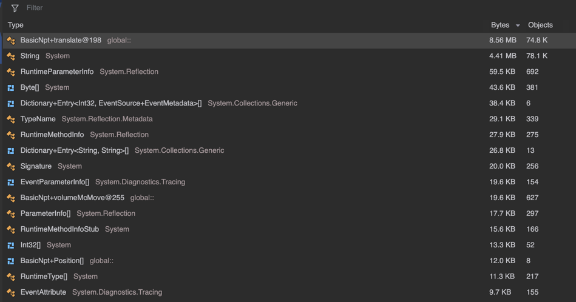

# 2026.11.01

Page 35, general `U_tot` for 
$$
\mathcal{U}^{\mathrm{tot}} = \sum_{i<j} u_c(r_{ij}) + \frac{N\rho}{2} \int_{r_c}^{\infty} \mathrm{d}r \, u(r) \, 4\pi r^2
$$

where 
$$
\frac{8}{3}\pi\rho\epsilon\sigma^3 \left[ \frac{1}{3}\left(\frac{\sigma}{r_c}\right)^9 - \left(\frac{\sigma}{r_c}\right)^3 \right]
$$

for number density `\rho`. 

Other math that matters is that 10^6 Pa is 0.00624 eV nm^-3, which has much more convienent units.

Using the LJ paramaters of `\frac{\epsilon}/{k_B} = 120 K` and `\sigma = 0.34 \mathrm{nm}` for
Argon seems appropriate.

NPT algorithim shown on page 121

# 2026.11.03

Basic NPT-Ensemble Simulation 
```
PROGRAM mc_npt                    basic NPT ensemble simulation

do icycl=1,ncycl                  perform ncycl MC cycles
  ran=ranf()*(npart+1)+1
  if (ran.le.npart) then
    call mcmove                   perform particle displacement
  else
    call mcvol                    perform volume change
  endif
  if (mod(icycl,nsamp).eq.0)
+   call sample                   sample averages
enddo
end
```

```
SUBROUTINE mcvol                          attempts to change
                                          the volume
call toterg(box,eno)                      total energy old conf.
vo=box**3                                 determine old volume
lnvn=log(vo)+(ranf()-0.5)*vmax            perform random walk in ln V
vn=exp(lnvn)
boxn=vn**(1/3)                            new box length
do i=1,npart
  x(i)=x(i)*boxn/box                      rescale center of mass
enddo
call toterg(boxn,enn)                     total energy new conf.
arg=-beta*((enn-eno)+p*(vn-vo)
+ -(npart+1)*log(vn/vo)/beta)             appropriate weight function!
if (ranf().gt.exp(arg)) then              acceptance rule (5.2.3)
  do i=1,npart                            REJECTED
    x(i)=x(i)*box/boxn                    restore the old positions
  enddo
endif
return
end
```

Basic metroplis displacement

```
SUBROUTINE mcmove                         attempts to displace a particle

o=int(ranf()*npart)+1                     select a particle at random
call ener(x(o),eno)                       energy old configuration
xn=x(o)+(ranf()-0.5)*delx                 give particle random displacement
call ener(xn,enn)                         energy new configuration
if (ranf().lt.exp(-beta                   acceptance rule (3.2.1)
+   *(enn-eno)) x(o)=xn                   accepted: replace x(o) by xn
return
end
```

Two places where I'm thinking 'I know there must be a better way to math this out' is a) equal distribution of unique 
pairs to sum over and b) periodic boundary condition distances

I think there is probably a way to avoid the modulos, but I'm not positive.

Also, very annoying that the runtime does not provide a threadpool and I just have to trust it; I'd like to 
deterministically prove that only a CPU number of threads are run.

┌───────────────┬──────────────┐
│    a          │    a         │
│               │              │
│               │              │
│               │              │
│            y  │           y  │
│ x             │ x            │
└───────────────└──────────────┘

Okay another note - it is frustrating that `**` is not unit aware. I also think that a written explanation of 
`ThreadIndexBins` will make sense. If there were three molecules and two bins, the pairs would be 
`[[(1, 2); (1, 3)]; [(2; 3)]`. For 4, `[[(1, 2); (1, 3); (1, 4)]; [(2, 3); (2, 4); (3, 4)]]]`.

# 2026.11.10

Measurements saved me:
```fsharp
let mistake = existingDimension * (rand - 0.5) * sc.CutoffRadius
let correct = existingDimension + (rand - 0.5) * sc.CutoffRadius 
```

I had an epiphany while calculating the `translationalMcMove` that there is no reason to recalculate the energy: 
when the positions are first created they should be created with the starting energy.

# 2026.11.11

For volume moves it makes sense to preallocate the buffer where the newly translated particles will be placed into. 
Otherwise lots of needless allocation

# 2026.11.12

I can only imagine that doing the volume normalization multithreaded isn't any more efficient, but that will be 
something to actually test
 
# 2026.11.14

Did not konw that scientific notation was supported by F#!
Remark on `e037264` 

That is a lot of `translate` allocations that can probably be avoided?



Attempting to optimise `this.Pairwise` because this is more interesting. Each run taken under profiler with sampling. 
So admitedly not the best way to do this

`d47e311`
25, 26, 25

`$commit`
34, 34, 34